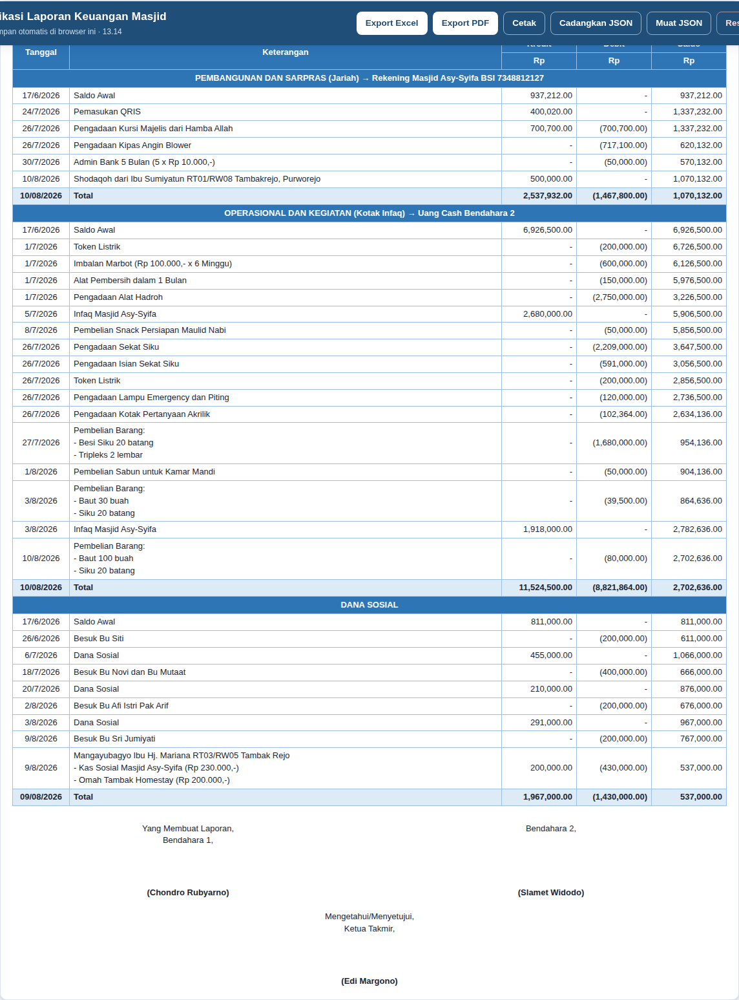
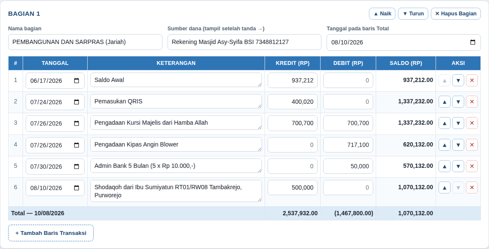

# Aplikasi Laporan Keuangan Masjid

Aplikasi web sederhana untuk menyusun laporan keuangan masjid dengan format
persis seperti contoh laporan Masjid Asy-Syifa: beberapa bagian sumber dana,
kolom **Tanggal – Keterangan – Kredit – Debit – Saldo**, baris **Total** per
bagian, dan blok tanda tangan di bawahnya.

Hasilnya bisa diekspor ke **PDF** dan **Excel (.xlsx)**. Pada berkas Excel,
kolom Saldo dan seluruh baris Total ditulis sebagai **rumus yang hidup**, bukan
angka mati — jadi begitu angka Kredit/Debit diubah di Excel, saldonya langsung
ikut terhitung. Ada pula sheet khusus yang menjelaskan setiap rumus diambil dari
sel mana.



## Cara memakai

Tidak perlu memasang apa pun dan tidak perlu internet.

1. Unduh seluruh isi folder ini (tombol **Code → Download ZIP** di GitHub), lalu
   ekstrak.
2. Buka berkas **`index.html`** dengan klik dua kali (Chrome, Edge, atau Firefox).
3. Aplikasi terbuka berisi contoh laporan. Ubah datanya sesuai kebutuhan.

Kalau ingin diakses bersama dari HP pengurus lain, folder ini juga bisa
diunggah apa adanya ke GitHub Pages atau hosting statis mana pun.

## Tampilan aplikasi

Aplikasi punya dua tab:

| Tab | Isi |
| --- | --- |
| **Entri Data** | Tempat mengetik transaksi. Saldo dan Total terhitung otomatis setiap kali mengetik. |
| **Pratinjau Laporan** | Tampilan laporan jadi, sama persis dengan hasil PDF dan Excel. |



### Mengisi transaksi

- **Tanggal** — tanggal transaksi.
- **Keterangan** — boleh lebih dari satu baris. Tekan `Enter` di dalam kotak
  untuk membuat rincian, misalnya:

  ```
  Pembelian Barang:
  - Besi Siku 20 batang
  - Tripleks 2 lembar
  ```

- **Kredit** — uang masuk (termasuk baris *Saldo Awal*).
- **Debit** — uang keluar. Cukup ketik angka positifnya; di laporan otomatis
  ditampilkan dalam kurung, misalnya `(717,100.00)`.
- Satu baris boleh berisi Kredit **dan** Debit sekaligus, seperti baris
  *Pengadaan Kursi Majelis* pada contoh.
- Angka boleh diketik bebas: `1500000`, `1.500.000`, atau `1,500,000` sama saja.

Tombol ▲ ▼ ✕ di kolom Aksi dipakai untuk memindahkan atau menghapus baris.

### Mengatur bagian

Setiap sumber dana adalah satu **Bagian** (pada contoh ada tiga: Pembangunan dan
Sarpras, Operasional dan Kegiatan, serta Dana Sosial). Untuk tiap bagian bisa
diatur nama bagian, sumber dana (teks setelah tanda →), dan tanggal yang muncul
di baris Total. Bagian baru ditambahkan lewat tombol
**+ Tambah Bagian / Sumber Dana**.

## Aturan perhitungan

Aturan yang sama dipakai di layar, di PDF, dan sebagai rumus di Excel:

| Yang dihitung | Cara menghitung |
| --- | --- |
| Saldo baris pertama sebuah bagian | `Kredit − Debit` |
| Saldo baris berikutnya | `Saldo baris sebelumnya + Kredit − Debit` |
| Total Kredit | jumlah seluruh Kredit di bagian tersebut |
| Total Debit | jumlah seluruh Debit di bagian tersebut |
| Saldo Akhir (baris Total) | `Total Kredit − Total Debit` |

Saldo Akhir selalu sama dengan saldo pada baris terakhir. Sheet **Rumus** di
berkas Excel ikut memeriksa hal ini secara otomatis dan menuliskan
`COCOK` bila keduanya sama.

## Export Excel

Tombol **Export Excel** menghasilkan berkas `.xlsx` berisi tiga sheet.

### 1. Sheet `Laporan`

Tampilan laporan lengkap dengan pewarnaan seperti contoh. Kolomnya:

| Kolom | Isi |
| --- | --- |
| A | Tanggal |
| B | Keterangan |
| C | Kredit |
| D | Debit |
| E | Saldo |

Yang ditulis sebagai rumus:

| Sel | Rumus | Diambil dari |
| --- | --- | --- |
| `E5` (baris pertama sebuah bagian) | `=C5-D5` | Kredit dikurangi Debit pada baris yang sama |
| `E6`, `E7`, … | `=E5+C6-D6` | Saldo baris di atasnya, ditambah Kredit dan dikurangi Debit baris ini |
| `C11` (Total Kredit) | `=SUM(C5:C10)` | Seluruh Kredit bagian tersebut |
| `D11` (Total Debit) | `=SUM(D5:D10)` | Seluruh Debit bagian tersebut |
| `E11` (Saldo Akhir) | `=C11-D11` | Total Kredit dikurangi Total Debit |

(Nomor baris di atas mengikuti contoh bawaan; pada laporan lain nomornya
menyesuaikan, dan sheet `Rumus` selalu menyebut nomor yang benar.)

Sel Total juga diberi **catatan sel** — arahkan kursor ke sel tersebut di Excel
untuk membaca penjelasan rumusnya.

### 2. Sheet `Ringkasan`

Rekap per bagian. Angkanya tidak diketik ulang, melainkan menunjuk ke baris
Total di sheet `Laporan`, misalnya `=Laporan!C11`, `=Laporan!D11`,
`=Laporan!E11`. Baris paling bawah menjumlahkan seluruh bagian dengan `SUM`,
sehingga terlihat total kas masjid secara keseluruhan.

### 3. Sheet `Rumus`

Daftar lengkap setiap sel berumus: nomor selnya, rumusnya, penjelasan angkanya
diambil dari sel mana, dan hasilnya. Sheet inilah jawaban atas pertanyaan
"angka ini datangnya dari mana?" — termasuk baris pemeriksaan yang
membandingkan Saldo Akhir dengan saldo baris terakhir.

### Format angka di Excel

- Kredit: `#,##0.00;-#,##0.00;"-"`
- Debit: `(#,##0.00);(#,##0.00);"-"` → angka positif tetap tampil dalam kurung
- Saldo: `#,##0.00;(#,##0.00);"-"`

Nilai nol ditampilkan sebagai `-`, sama seperti pada contoh laporan.

## Export PDF dan cetak

- **Export PDF** — mengunduh berkas PDF ukuran A4 tegak, lengkap dengan blok
  tanda tangan. Kepala tabel diulang bila laporan lebih dari satu halaman.
- **Cetak** — membuka dialog cetak bawaan browser dengan hanya bagian laporan
  yang tercetak (tombol dan form editor tidak ikut). Dari dialog ini bisa juga
  dipilih "Save as PDF".

Catatan: font bawaan pembuat PDF hanya mengenal karakter Latin, sehingga tanda
panah `→` pada judul bagian ditampilkan sebagai `»` khusus di berkas PDF. Di
layar dan di Excel tetap `→`.

## Menyimpan data

- Data tersimpan **otomatis di browser** (localStorage) setiap kali ada
  perubahan. Menutup lalu membuka kembali `index.html` akan memuat data terakhir.
- Penyimpanan browser terikat pada satu komputer dan satu browser. Untuk
  memindahkan atau mengarsipkan data, gunakan **Cadangkan JSON** lalu
  **Muat JSON** di komputer lain.
- **Reset** menghapus data yang sedang dibuka dan menawarkan mulai dari kosong
  atau memuat ulang contoh. Lakukan **Cadangkan JSON** lebih dulu.

> Disarankan menekan **Cadangkan JSON** setiap selesai menyusun laporan bulanan,
> dan menyimpan berkas itu bersama PDF-nya.

## Struktur berkas

```
index.html                       halaman aplikasi
assets/css/app.css               tampilan aplikasi dan aturan cetak
assets/js/format.js              format angka dan tanggal
assets/js/model.js               struktur data dan seluruh perhitungan saldo
assets/js/store.js               simpan di browser, cadangan JSON, unduh berkas
assets/js/export-excel.js        penyusun berkas .xlsx beserta rumusnya
assets/js/export-pdf.js          penyusun berkas .pdf
assets/js/app.js                 penghubung data dengan tampilan
vendor/                          pustaka pihak ketiga (disertakan agar jalan tanpa internet)
docs/                            tangkapan layar untuk dokumentasi ini
```

Aplikasi ditulis dengan JavaScript biasa tanpa proses *build*, sehingga berkas
di repositori ini sama persis dengan yang dijalankan browser.

### Pustaka yang dipakai

| Pustaka | Versi | Kegunaan | Lisensi |
| --- | --- | --- | --- |
| [ExcelJS](https://github.com/exceljs/exceljs) | 4.4.0 | membuat berkas `.xlsx` berumus | MIT |
| [jsPDF](https://github.com/parallax/jsPDF) | 2.5.2 | membuat berkas PDF | MIT |
| [jspdf-autotable](https://github.com/simonbengtsson/jsPDF-AutoTable) | 3.8.4 | menyusun tabel di PDF | MIT |

Salinan lisensinya ada di dalam folder `vendor/`.
